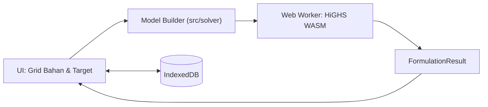

# 🌾 Open Formul

> Aplikasi web open-source dan _offline-capable_ (PWA) untuk **formulasi pakan ternak presisi**: _least-cost ration formulation_ dengan pemenuhan kebutuhan nutrien otomatis via _Linear Programming_ langsung di browser.

[](LICENSE)


---

## 🎯 Masalah yang Diselesaikan

Biaya pakan mencapai **60–70% biaya produksi** peternakan. Peternak kecil, mahasiswa, dan penyuluh sering menyusun ransum dengan metode _trial-and-error_, _Pearson Square_, atau spreadsheet manual yang:

- hanya bisa menyeimbangkan 1–2 nutrien sekaligus,
- tidak menjamin biaya termurah,
- rawan salah hitung (basis _As-Fed_ vs Bahan Kering tercampur),
- sering membutuhkan perangkat lunak berbayar dan koneksi internet.

**Open Formul** menyelesaikan ini dengan solver LP (HiGHS WebAssembly) yang berjalan **sepenuhnya di sisi klien**, gratis, dan tetap bekerja tanpa internet di lapangan.

## ✨ Fitur Utama

| Fitur                              | Deskripsi                                                                                                           |
| ---------------------------------- | ------------------------------------------------------------------------------------------------------------------- |
| ⚙️ **Kalkulasi otomatis**          | Menghitung komposisi ransum termurah yang memenuhi semua batasan nutrien (min/max).                                 |
| 🧪 **Kustomisasi bahan & nutrien** | Tambah bahan lokal, ubah harga, definisikan nutrien sendiri (PK, EM, TDN, SK, Ca, P, Lisin, Metionin, dll).         |
| 📏 **Batas inklusi bahan**         | Atur persentase minimum/maksimum tiap bahan (mis. dedak ≤ 20%).                                                     |
| 🔄 **As-Fed ↔ Bahan Kering**       | Konversi basis nutrien yang konsisten.                                                                              |
| 🚫 **Deteksi _infeasible_**        | Memberi tahu bila target mustahil dicapai beserta petunjuk kendala penyebabnya.                                     |
| 📴 **Mode offline**                | PWA + IndexedDB: data dan formulasi tersimpan lokal.                                                                |
| 📤 **Ekspor/impor**                | `.feed.json` (v1), CSV partial-merge, Excel `.xlsx` (OOXML), PDF 1.4 (lengkap & batch), serta TSV Multi-Cell Paste. |

## 🏗️ Arsitektur Teknologi

| Lapisan     | Teknologi                                                                                       |
| ----------- | ----------------------------------------------------------------------------------------------- |
| UI          | React + TypeScript + Tailwind CSS + Fontsource offline (`Plus Jakarta Sans` & `JetBrains Mono`) |
| Build       | Vite                                                                                            |
| Solver      | [HiGHS](https://highs.dev) WebAssembly (paket npm `highs`) — dijalankan di Web Worker           |
| Penyimpanan | IndexedDB                                                                                       |
| Offline     | Service Worker (PWA)                                                                            |



Detail: [docs/prd.md](docs/prd.md) · [docs/architecture.md](docs/architecture.md) · [docs/formulation-math.md](docs/formulation-math.md) · [docs/data-schema.md](docs/data-schema.md) · [docs/advanced-feature-research-plan.md](docs/advanced-feature-research-plan.md)

## 📁 Struktur Repositori

```
.
├── .github/              # Template issue, PR, & workflow GitHub Actions
├── android/              # Pembungkus aplikasi native Android (Capacitor 8)
├── docs/                 # Dokumentasi teknis, PRD, Desain, Roadmap, & arsip referensi
│   ├── DESIGN.md         # Referensi sistem desain (Linear-style)
│   ├── ROADMAP.md        # Peta jalan pengembangan & rilis
│   ├── prd.md            # Dokumen PRD & panduan lengkap seluruh fitur Open Formul
│   └── references/       # Arsip PDF & transkripsi lengkap tervalidasi (Hartadi 1980 JSON/MD & Kearl 1982 / NRC 1988 JSON/MD)
├── public/               # Aset publik PWA & ikon
├── src/
│   ├── components/       # Komponen React
│   ├── data/             # Sampel JSON, mock-state, pustaka penuh Hartadi 1980 (304 bahan), Kearl 1982 (82), & NRC 1988 (24)
│   ├── hooks/            # Custom React hooks (usePrototypeStore, usePwaStatus)
│   ├── solver/           # Engine optimasi LP murni + HiGHS WASM Web Worker (`ENG-01`–`ENG-08`)
│   ├── storage/          # Persistensi IndexedDB (`idb`), transfer `.feed.json`, ekspor CSV/`.xlsx`/PDF 1.4
│   ├── types/            # Tipe domain TypeScript
│   └── utils/            # Utilitas murni (basis, persamaan ruminansia/monogastrik, validator batas, impor/ekspor CSV, TSV paste)
├── src-tauri/            # Pembungkus aplikasi desktop Windows `.exe` (Tauri v2)
└── CONTRIBUTING.md
```

## 🌐 Akses Aplikasi & Unduh Lintas Platform (PC `.exe`, Android `.apk`, & PWA)

- **Unduh Installer Langsung ([GitHub Releases](https://github.com/Widyatama-Pro/Open-Formul/releases)):**
  - **Windows Desktop (`.exe`):** Unduh `Open-Formul-Windows-x64-setup.exe` (dibangun via **Tauri v2**, ringan memakai WebView2, 100% offline dengan dialog simpan file native).
  - **Android Mobile (`.apk`):** Unduh `Open-Formul-Android.apk` (dibangun via **Capacitor 8**, offline penuh dengan HiGHS WASM lokal serta tombol berbagi/simpan file ekspor ke perangkat).
  - **Portable Offline ZIP (Windows / macOS / Linux):** Unduh `open-formul-offline-portable.zip` lalu jalankan `start-windows.bat` / `start-mac-linux.sh`.
- **Aplikasi Web / PWA Langsung (GitHub Pages):** [`https://widyatama-pro.github.io/Open-Formul/`](https://widyatama-pro.github.io/Open-Formul/) _(aktif via workflow [deploy-pages.yml](.github/workflows/deploy-pages.yml) setelah Pages diset ke sumber **GitHub Actions** — dapat dipasang ke Desktop Chrome/Edge maupun Android Chrome / Safari iOS)._

> 🚀 **Fokus Rilis Saat Ini:** Seluruh **15 modul formulasi presisi, pabrik, dan keberlanjutan** (`PR-01..PR-05`, `ML-01..ML-05`, `EN-01..EN-05`) telah tersedia di menu **Modul Lanjutan (Advance)** dengan label **Coming Soon** & penjelasan fungsi sederhana sambil menuntaskan deploy publik terlebih dahulu. Rencana bedah teknis & dasar jurnalnya ada di [docs/advanced-feature-research-plan.md](docs/advanced-feature-research-plan.md).

## 🚀 Instalasi Lokal & Pengembang

> 💡 **Status Saat Ini (Fase 3 Selesai ✅):** Antarmuka Glass-Neumorphism responsif dengan _windowing_ progresif (`> 50` item), **engine LP HiGHS WASM di Web Worker** (`ENG-01`–`ENG-08`), **nutrien kustom penuh** (nama, satuan, basis dinamis pengguna), **persistensi offline IndexedDB (`open-formul-db` v1) + PWA (`vite-plugin-pwa` precache `.wasm`)**, **pustaka penuh Hartadi 1980 (304 bahan), Kearl 1982 (82 profil), & NRC 1988 (24 profil sapi perah)** beserta arsip lokal di [`docs/references/`](docs/references/), serta **ekspor/impor `.feed.json`, CSV partial-merge, Excel `.xlsx`, PDF 1.4 (`full` & `batch_only`), dan TSV Multi-Cell Paste** telah aktif. Item tersisa (internasionalisasi penuh & fitur lanjutan Fase 4) dipantau di [docs/ROADMAP.md](docs/ROADMAP.md).

Prasyarat pengembangan lokal: **Node.js ≥ 20** dan **npm ≥ 10**.

```bash
git clone https://github.com/Widyatama-Pro/Open-Formul.git
cd Open-Formul
npm install
npm run dev          # server pengembangan di http://localhost:5173
npm run typecheck    # verifikasi TypeScript ketat (tsc --noEmit)
npm run lint         # pemeriksaan ESLint + React Hooks
npm run format:check # cek format kode dengan Prettier
npm run test         # jalankan Vitest (unit + UI prototype flow)
npm run build        # build produksi TypeScript + Vite
```

## 🤝 Berkontribusi

Kami menyambut **programmer** maupun **ahli nutrisi ternak**! Baca [CONTRIBUTING.md](CONTRIBUTING.md), patuhi [CODE_OF_CONDUCT.md](CODE_OF_CONDUCT.md), dan lihat [docs/ROADMAP.md](docs/ROADMAP.md) untuk prioritas. Kontribusi data bahan pakan dapat diajukan via template issue **Feed Ingredient Data**.

Kerentanan keamanan: lihat [SECURITY.md](SECURITY.md).

## ⚠️ Disclaimer

Hasil formulasi bergantung pada akurasi data nutrien yang dimasukkan. Selalu validasi ransum dengan ahli nutrisi dan analisis laboratorium sebelum digunakan secara komersial.

## 📄 Lisensi

[MIT](LICENSE) © 2026 Reza Widya Utama dan kontributor.
