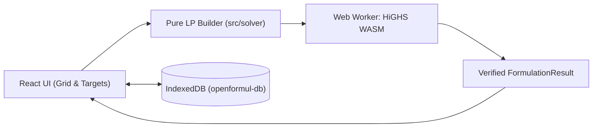

# OpenFormul 🌾 — Offline-first least-cost feed formulation in your browser

<p align="center">
  
</p>

<p align="center">
  <a href="https://github.com/Widyatama-Pro/OpenFormul/actions/workflows/ci.yml"></a>
  <a href="https://github.com/Widyatama-Pro/OpenFormul/releases"></a>
  <a href="LICENSE"></a>
  
  
  
</p>

**OpenFormul** is a client-side least-cost ration formulation engine powered by Linear Programming (HiGHS WebAssembly). It runs as an installable PWA in any modern browser, a native Windows desktop app via Tauri v2, and an offline Android app via Capacitor 8. Drop straight into existing spreadsheet and mill workflows with multi-cell TSV paste, CSV partial-merge, multi-sheet `.xlsx`, print-ready PDF 1.4 (`full` and `batch_only`), and portable `.feed.json` files. Under the hood, a pure TypeScript model builder compiles nutrient, ratio, and inclusion constraints into LP strings and solves them off the main thread in a Web Worker.

**Yours, with no catch.** Every ingredient catalog, custom price override, nutrient standard, and saved ration stays on your device in IndexedDB (`openformul-db`) with a precached `.wasm` Service Worker for zero-connectivity field work. No cloud account, no external solver API, and zero telemetry leave your machine. Open-source MIT code you can audit, fork, and run in air-gapped feed mills or research labs.

---

## Quick Start

Requires **Node.js >= 20** and **npm >= 10**.

```bash
git clone https://github.com/Widyatama-Pro/OpenFormul.git
cd OpenFormul
npm install
npm run dev
```

Verification suite:

```bash
npm run format:check
npm run typecheck
npm run lint
npm run test
npm run build
```

## Live App & Installers

- **Web / PWA (GitHub Pages):** [`https://widyatama-pro.github.io/OpenFormul/`](https://widyatama-pro.github.io/OpenFormul/)
- **Windows Desktop (`.exe`):** `OpenFormul-Windows-x64-setup.exe` via [GitHub Releases](https://github.com/Widyatama-Pro/OpenFormul/releases) (Tauri v2 + WebView2, native file save dialogs)
- **Android (`.apk`):** `OpenFormul-Android.apk` via [GitHub Releases](https://github.com/Widyatama-Pro/OpenFormul/releases) (Capacitor 8, local HiGHS WASM + native share/export)
- **Portable Offline ZIP:** `openformul-offline-portable.zip` (`start-windows.bat` / `start-mac-linux.sh`)

## Core Capabilities

- **HiGHS LP/SLP Solver in Web Worker:** 5 optimization modes (including Mode 5 Chebyshev minimax $\epsilon$-lexicographic), priority-tiered L1 elastic relaxation (`near_feasible`), Chinneck minimal IIS diagnostics, RHS validity ranges & directional duals, parametric Buy/No-Buy price ladder, Dinkelbach fractional cost-per-nutrient LP, Munford/Cantelli stochastic chance constraints, and sub-additive multi-enzyme matrices.
- **Consistent Nutritional Basis & Rumen Biology:** Automatic As-Fed ↔ Dry Matter (BK/DM) normalization (including stochastic $\sigma$ scaling), linearized nutrient ratios (`Ca:P`), active `dEB`/`DCAD` electrolyte balance, post-solve CNCPS v6.5 / NASEM 2021 rumen evaluation (`peuNDF240`, `DMI`, `kp`, `MCP`, `eCH4`), strict `0` vs `N/A` (`null`) distinction, and full custom nutrient definitions.
- **Built-in Reference Libraries & Full Bilingual UI (`ID / EN`):** 304 feeds from Hartadi 1980, 82 Kearl 1982 profiles, and 24 NRC 1988 dairy profiles archived under [`docs/references/`](docs/references/), plus complete Indonesian/English localization (`src/i18n/`).
- **Spreadsheet & Mill I/O:** Excel/Sheets TSV block paste directly into the ingredient grid, non-destructive CSV/JSON merge, `.feed.json` (v1) recipe portability, `.xlsx` workbooks, and operator-safe `batch_only` PDFs gated on `optimal` solver status.

## Architecture



```text
src/
├── components/   # Precision Agritech UI, formulation grid, precision LP modal, analytics, export dialogs
├── data/         # Sample JSON, Hartadi 1980 (304), Kearl 1982 (82), NRC 1988 (24)
├── hooks/        # Store orchestration & PWA lifecycle hooks
├── i18n/         # Full ID / EN localization helpers & conflict translators
├── solver/       # Pure LP/SLP builder, IIS, stepping, stochastic, enzymes, rumen evaluator, HiGHS worker
├── storage/      # IndexedDB (idb), .feed.json, CSV/OOXML .xlsx, PDF 1.4 generators
├── types/        # Canonical domain TypeScript types
└── utils/        # Basis math, nutrition equations, validators, TSV paste
```

## Documentation & Contributing

- **Docs:** [docs/architecture.md](docs/architecture.md) · [docs/formulation-math.md](docs/formulation-math.md) · [docs/data-schema.md](docs/data-schema.md) · [docs/prd.md](docs/prd.md) · [docs/ROADMAP.md](docs/ROADMAP.md)
- **Contributing:** Read [CONTRIBUTING.md](CONTRIBUTING.md) and [CODE_OF_CONDUCT.md](CODE_OF_CONDUCT.md) before opening a PR.
- **Security:** Report client-side, parser, or WASM issues privately via [SECURITY.md](SECURITY.md).

> **Disclaimer:** Formulation outputs depend on the accuracy of entered nutrient and price data. Validate rations against laboratory assays and qualified animal nutritionists before commercial mixing.

## License

[MIT](LICENSE) © 2026 Reza Widya Utama and contributors.
