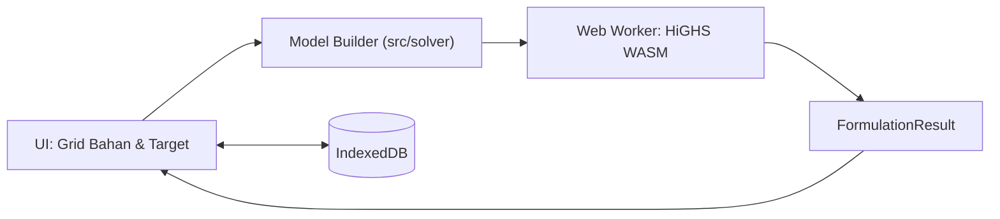

# 🌾 Open Formul

> Aplikasi web open-source dan _offline-capable_ (PWA) untuk **formulasi pakan ternak presisi**: _least-cost ration formulation_ dengan pemenuhan kebutuhan nutrien otomatis via _Linear Programming_ langsung di browser.

[](LICENSE)


---

## 🎯 Masalah yang Diselesaikan

Biaya pakan mencapai **60–70% biaya produksi** peternakan. Peternak kecil, mahasiswa, dan penyuluh sering menyusun ransum dengan metode _trial-and-error_, _Pearson Square_, atau spreadsheet manual yang:

- hanya bisa menyeimbangkan 1–2 nutrien sekaligus,
- tidak menjamin biaya termurah,
- rawan salah hitung (basis _As-Fed_ vs Bahan Kering tercampur),
- sering membutuhkan perangkat lunak berbayar dan koneksi internet.

**Open Formul** menyelesaikan ini dengan solver LP (HiGHS WebAssembly) yang berjalan **sepenuhnya di sisi klien**, gratis, dan tetap bekerja tanpa internet di lapangan.

## ✨ Fitur Utama

| Fitur                              | Deskripsi                                                                                                           |
| ---------------------------------- | ------------------------------------------------------------------------------------------------------------------- |
| ⚙️ **Kalkulasi otomatis**          | Menghitung komposisi ransum termurah yang memenuhi semua batasan nutrien (min/max).                                 |
| 🧪 **Kustomisasi bahan & nutrien** | Tambah bahan lokal, ubah harga, definisikan nutrien sendiri (PK, EM, TDN, SK, Ca, P, Lisin, Metionin, dll).         |
| 📏 **Batas inklusi bahan**         | Atur persentase minimum/maksimum tiap bahan (mis. dedak ≤ 20%).                                                     |
| 🔄 **As-Fed ↔ Bahan Kering**       | Konversi basis nutrien yang konsisten.                                                                              |
| 🚫 **Deteksi _infeasible_**        | Memberi tahu bila target mustahil dicapai beserta petunjuk kendala penyebabnya.                                     |
| 📴 **Mode offline**                | PWA + IndexedDB: data dan formulasi tersimpan lokal.                                                                |
| 📤 **Ekspor/impor**                | `.feed.json` (v1), CSV partial-merge, Excel `.xlsx` (OOXML), PDF 1.4 (lengkap & batch), serta TSV Multi-Cell Paste. |

## 🏗️ Arsitektur Teknologi

| Lapisan     | Teknologi                                                                                       |
| ----------- | ----------------------------------------------------------------------------------------------- |
| UI          | React + TypeScript + Tailwind CSS + Fontsource offline (`Plus Jakarta Sans` & `JetBrains Mono`) |
| Build       | Vite                                                                                            |
| Solver      | [HiGHS](https://highs.dev) WebAssembly (paket npm `highs`) — dijalankan di Web Worker           |
| Penyimpanan | IndexedDB                                                                                       |
| Offline     | Service Worker (PWA)                                                                            |



Detail: [prd.md](prd.md) · [docs/architecture.md](docs/architecture.md) · [docs/formulation-math.md](docs/formulation-math.md) · [docs/data-schema.md](docs/data-schema.md)

## 📁 Struktur Repositori

```
.
├── .agent/skills/        # Instruksi modular untuk AI agent (domain, UI/UX, & agency-agents)
├── .gemini/GEMINI.md     # Aturan workspace & aktivasi ekosistem UI/UX untuk Gemini/Antigravity
├── .github/              # Template issue & PR
├── docs/                 # Dokumentasi teknis
├── project-brief/        # Dokumen brief spesifikasi fitur & analisis arsitektur industri
├── src/
│   ├── components/       # Komponen React
│   ├── data/             # Sampel JSON, dataset kerja, bahan Indonesia (Hartadi), & profil Kearl (1982)
│   ├── hooks/            # Custom React hooks (usePrototypeStore, usePwaStatus)
│   ├── solver/           # Engine optimasi LP murni + HiGHS WASM Web Worker (`ENG-01`–`ENG-08`)
│   ├── storage/          # Persistensi IndexedDB (`idb`), transfer `.feed.json`, ekspor CSV/`.xlsx`/PDF 1.4
│   ├── types/            # Tipe domain TypeScript
│   └── utils/            # Utilitas murni (basis, persamaan, validator batas, impor CSV, TSV paste, unduh)
├── AGENTS.md             # Aturan global & standar UI/UX wajib untuk AI agent
├── DESIGN.md             # Referensi sistem desain root (Linear-style)
├── prd.md                # Dokumen PRD & panduan lengkap seluruh fitur Open Formul
├── ROADMAP.md
└── CONTRIBUTING.md
```

## 🚀 Instalasi Lokal

> 💡 **Status Saat Ini:** Antarmuka Glass-Neumorphism responsif, **engine LP HiGHS WASM di Web Worker** (`ENG-01`–`ENG-08`), **persistensi offline IndexedDB (`open-formul-db` v1) + PWA (`vite-plugin-pwa` precache `.wasm`)**, **dataset lokal Indonesia (14 bahan Hartadi + 6 profil Kearl 1982)**, serta **ekspor/impor `.feed.json`, CSV partial-merge, Excel `.xlsx`, PDF 1.4 (`full` & `batch_only`), dan TSV Multi-Cell Paste** telah aktif. Item tersisa (nutrien kustom penuh & internasionalisasi lengkap) dipantau di [ROADMAP.md](ROADMAP.md).

Prasyarat: **Node.js ≥ 20** dan **npm ≥ 10**.

```bash
git clone https://github.com/<org>/open-formul.git
cd open-formul
npm install
npm run dev          # server pengembangan di http://localhost:5173
npm run typecheck    # verifikasi TypeScript ketat (tsc --noEmit)
npm run lint         # pemeriksaan ESLint + React Hooks
npm run format:check # cek format kode dengan Prettier
npm run test         # jalankan Vitest (unit + UI prototype flow)
npm run build        # build produksi TypeScript + Vite
```

## 🤝 Berkontribusi

Kami menyambut **programmer** maupun **ahli nutrisi ternak**! Baca [CONTRIBUTING.md](CONTRIBUTING.md), patuhi [CODE_OF_CONDUCT.md](CODE_OF_CONDUCT.md), dan lihat [ROADMAP.md](ROADMAP.md) untuk prioritas. Kontribusi data bahan pakan dapat diajukan via template issue **Feed Ingredient Data**.

Kerentanan keamanan: lihat [SECURITY.md](SECURITY.md).

## ⚠️ Disclaimer

Hasil formulasi bergantung pada akurasi data nutrien yang dimasukkan. Selalu validasi ransum dengan ahli nutrisi dan analisis laboratorium sebelum digunakan secara komersial.

## 📄 Lisensi

[MIT](LICENSE) © 2026 Reza Widya Utama dan kontributor.
