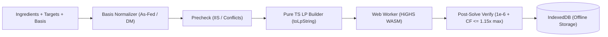

# OpenFormu 🌾 — Offline-first least-cost feed formulation engine

<p align="center">
  
</p>

<p align="center">
  <a href="https://github.com/Widyatama-Pro/OpenFormu/actions/workflows/ci.yml"></a>
  <a href="https://github.com/Widyatama-Pro/OpenFormu/releases"></a>
  
  
  <a href="LICENSE"></a>
</p>

**OpenFormu** is a client-side least-cost ration formulation engine powered by Linear Programming (HiGHS WebAssembly). It runs as an installable PWA in any modern browser, a native Windows desktop executable via Tauri v2, and an offline Android application via Capacitor 8. Drop straight into existing feed mill and spreadsheet workflows with multi-cell TSV paste, CSV partial-merge, multi-sheet `.xlsx`, print-ready PDF 1.4 (`full` and `batch_only`), and portable `.feed.json` files. Under the hood, a pure TypeScript model builder compiles nutrient, ratio, and inclusion constraints into CPLEX LP models and solves them off the main thread in a Web Worker.

**100% local & offline-first.** Every ingredient catalog, custom price override, nutrient standard, and saved ration stays on your device in IndexedDB with a precached `.wasm` Service Worker for zero-connectivity field work. No cloud account, no external solver API, and zero telemetry leave your machine. Open-source MIT code you can audit, fork, and run in air-gapped feed mills or research laboratories.

---

## Core Capabilities

- **Exact Client-Side LP & Goal Programming (`HiGHS` WASM):** Compiles decision variables $x_i \in [0, 1]$ ($\sum x_i = 1$) in pure `As-Fed` or `Dry Matter (BK)` basis after automatic normalization, running off the main thread with stale-ticket cancellation and `1e-6` post-solve mathematical verification against manual nutrient recalculation. Supports **Modes 1–5** (pure Least-Cost through High-Precision Chebyshev minimax deviation) as well as **Range (Min–Max)** and **Single-Target Approach** constraints.
- **Built-In Local Nutrition Libraries & Dynamic Cattle Calculators:** Ships with sourced feed composition data (**304** Hartadi 1980 feeds with Table 12/13/14 merges and 44 mineral supplements), **22** SNI poultry & ruminant standards, **82** Kearl (1982) Table 14 beef/working/gestation profiles, **24** NRC (1988) dairy profiles, plus dynamic **Beef Cattle (Kearl 1982)** and **Dairy Cattle (Kearl 1982 / NRC 1988)** piecewise interpolation & extrapolation calculators (computing DMI, 4% FCM, `CP`, `TDN`, `EE`, `CF`, `Ca`, and `P` with step-by-step transparent breakdown).
- **Industrial-Grade Precision & Conflict Diagnostics:**
  - **`PR-01` Minimal IIS & Priority Tiers:** Chinneck Deletion Filter isolates exact conflicting nutrient, ratio (`Ca:P`), or ingredient-group constraints across tiers (`tier0` hard to `tier3` soft), with farmer-friendly `Toleransi Target` ($\ell_1$ relaxation) guarded by an asymmetric **Crude Fiber (`cf`) hard ceiling of `+15%` above `max` (`max * 1.15`)**.
  - **`PR-02` Sensitivity, Bound Duals & Price Ladder:** Extracts `shadowPrice` (including directional degenerate duals), `opportunityCosts` for unused feeds, inclusion bound duals, and parametric Critical-Region price stepping (`computeCriticalRegionStepping`).
  - **`PR-03` Fractional Objective & `dEB/DCAD`:** Charnes–Cooper / Dinkelbach iteration minimizing `Cost / Nutrient` (e.g. IDR per Mcal ME) alongside active dietary electrolyte balance calculations.
  - **`PR-04` Stochastic SLP (Munford):** Accounts for ingredient nutrient variance ($\sigma$) using Gaussian quantiles $\Phi^{-1}(p)$ or distribution-free Cantelli bounds.
  - **`PR-05` Sub-Additive Multi-Enzymes & Algebraic Rumen Evaluator:** Models phytase/xylanase/protease uplift bounded by substrate availability (`phytateP`) with thermal pelleting retention, plus CNCPS v6.5 / NASEM 2021 ruminal passage, microbial protein, `peuNDF240`, `eCH4`, and acidosis risk estimation.
- **Data Exchange & Offline Storage:** Multi-cell TSV paste from spreadsheets, CSV partial-merge without wiping missing columns, OOXML `.xlsx` multi-sheet workbooks, PDF 1.4 formulation/batch/database reports (with batch safety gating if infeasible), portable `.feed.json` transfer, custom user-defined nutrients, and bilingual (`ID / EN`) domain messages.

---

## Scope & Mathematical Limitations

- **Mathematically Infeasible / Extreme Standards Cannot Be Forced:** If ingredient profiles and inclusion limits cannot physically satisfy active hard targets (e.g., requesting higher protein, energy, and low fiber simultaneously than any combination of available ingredients permits), the solver strictly reports `infeasible` (**Formula Tidak Ditemukan**) rather than fabricating invalid or unverified ratios.
- **Asymmetric Crude Fiber (`cf`) Hard Ceiling (`+15%` Above Max):** Under `Toleransi Target` (`elasticMode`), high-fiber ingredients are allowed wider flexibility below `min` (`cf` shortage is tolerated at a lower penalty tier), **but exceeding `max` is strictly hard-capped at `<= max * 1.15`**. Any ration exceeding `+15%` above the maximum Crude Fiber limit is rejected as `infeasible`.
- **Strict `0` vs `N/A` (`null`) Distinction:** Missing nutrient values (`null`) are never silently treated as `0`. Formulating in Advance / Amino Acid mode when selected ingredients lack lab values raises an `ADVANCE_NULL_DATA` advisory warning so unmeasured nutrients are not miscounted as zero contribution.
- **Linear Optimization Scope:** Core formulation uses linear / successive-linear programming (non-linear biological curves outside `PR-04` SLP and algebraic CNCPS/NASEM post-evaluation are approximated linearly). Enterprise multi-plant warehouse allocation, direct PLC/FT-NIR hardware feeds, and dynamic statutory legal-label generation are intentionally outside offline client scope (`Out of Scope`).

---

## Platforms & Downloads

- **Web / PWA (GitHub Pages):** [`https://widyatama-pro.github.io/OpenFormu/`](https://widyatama-pro.github.io/OpenFormu/)
- **Windows Desktop (`.exe`):** `OpenFormu-Windows-x64-setup.exe` via [GitHub Releases](https://github.com/Widyatama-Pro/OpenFormu/releases) (Tauri v2 + WebView2, maximized launch, native file dialogs & external browser links)
- **Android (`.apk`):** `OpenFormu-Android.apk` via [GitHub Releases](https://github.com/Widyatama-Pro/OpenFormu/releases) (Capacitor 8, local HiGHS WASM & native Share/Export)
- **Portable Offline ZIP:** `openformu-offline-portable.zip` (`start-windows.bat` / `start-mac-linux.sh`)

---

## Architecture



---

## Quick Start (Development)

```bash
git clone https://github.com/Widyatama-Pro/OpenFormu.git
cd OpenFormu
npm install
npm run dev
```

Verification gates before committing:

```bash
npm run format:check
npm run typecheck
npm run lint
npm test -- --run
npm run build
```

---

## Documentation & License

- [System Architecture](docs/architecture.md)
- [Formulation Mathematics](docs/formulation-math.md)
- [Data Schema](docs/data-schema.md)
- [Roadmap](docs/ROADMAP.md)
- [Contributing Guide](CONTRIBUTING.md) · [Security Policy](SECURITY.md)

Licensed under the [MIT License](LICENSE).
