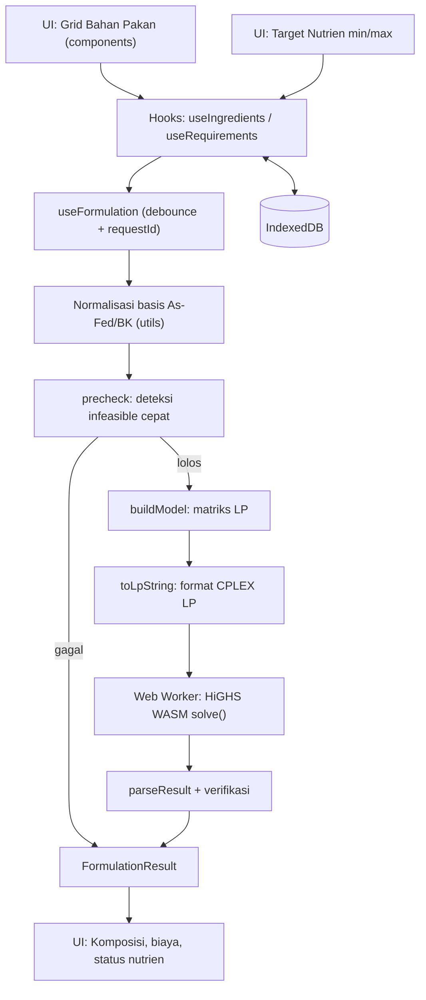
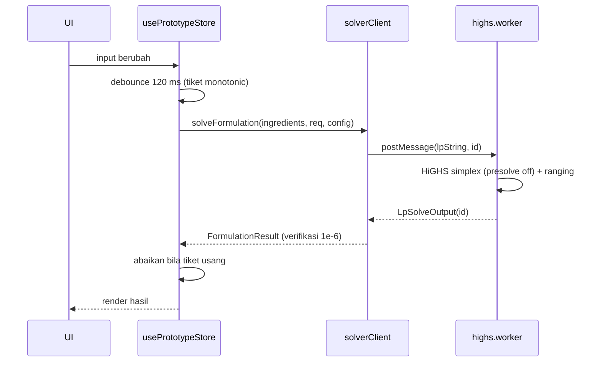

# Arsitektur OpenFormul

## Prinsip

1. **Client-side only** — tidak ada backend; solver berjalan di browser.
2. **Offline-first** — semua aset di-cache Service Worker, data di IndexedDB.
3. **Domain murni** — `src/solver` dan `src/utils` bebas React sehingga mudah diuji.

## Alur Data

## Urutan Eksekusi Solve

## Modul

| Folder           | Tanggung jawab                                                                                                                                                          |
| ---------------- | ----------------------------------------------------------------------------------------------------------------------------------------------------------------------- |
| `src/types`      | Tipe domain kanonik                                                                                                                                                     |
| `src/data`       | Sampel bahan JSON, dataset kerja (`mock-state`), **304 bahan** Hartadi 1980 (`hartadi-feeds`), **82 profil** Kearl 1982 & **24 profil** NRC 1988 (`kearl-requirements`) |
| `src/solver`     | `precheck`, `buildModel`, `toLpString`, `parseResult`, `solveFormulation`, `highs.worker`, `solverClient`                                                               |
| `src/storage`    | `db` (IndexedDB `idb` `openformul-db` v1), `recipeTransfer` (`.feed.json`), `exportCsvXlsx` (CSV BOM & OOXML `.xlsx`), `exportPdf` (PDF 1.4)                            |
| `src/utils`      | `basis` (As-Fed ↔ BK), `equations`, `validators`, `ingredientCsvImport`, `tsvPaste`, `download`, `locale-number`, `cn`                                                  |
| `src/hooks`      | `usePrototypeStore` (orkestrasi solve live, hidrasi & persistensi IDB, non-destructive `loadRecipe`), `usePwaStatus`                                                    |
| `src/components` | UI presentasional (Layered Glassmorphism & Soft Neumorphism, Light/Dark, offline font via `@fontsource-variable/*`)                                                     |

## Offline, PWA & Deploy Lintas Platform (Fase 4)

- `vite-plugin-pwa` (`mode: "generateSW"`, `registerType: "autoUpdate"`) dengan `base` dinamis via `VITE_BASE_PATH` (`/OpenFormul/` di GitHub Pages, `/` di lokal/root), `start_url: "./"`, `scope: "./"`, dan `maximumFileSizeToCacheInBytes: 6 * 1024 * 1024` untuk _precache_ aset statis serta `highs-*.wasm`.
- **Instalasi Desktop & Mobile (`usePwaStatus.ts`):** Menangkap `beforeinstallprompt` dan menyediakan tombol instalasi native di `AppShell` dan `SettingsPage` + bundel portabel di GitHub Releases.
- **Aplikasi Native PC `.exe` & Android `.apk`:** Selain PWA web, repositori dibungkus dengan **Tauri v2** (`src-tauri/`) untuk installer Windows NSIS (`.exe`) dan **Capacitor 8** (`android/`, `capacitor.config.json`) untuk Android (`.apk`) menggunakan script `npm run build:native` (`mode === "native"`, menonaktifkan registrasi Service Worker agar aset lokal langsung dijalankan WebView). Ekspor file di [download.ts](../src/utils/download.ts) otomatis memilih dialog Save As (`@tauri-apps/plugin-dialog` + `@tauri-apps/plugin-fs`), Android Share/Filesystem (`@capacitor/filesystem` + `@capacitor/share`), atau Blob web sesuai runtime.
- IndexedDB via `idb` (`openformul-db` v1) dengan 5 object store: `ingredients`, `requirements`, `recipes`, `active_session`, dan `preferences` (beserta fallback memori aman jika IndexedDB diblokir/tidak tersedia).
- **Katalog Lanjutan (`AdvancedModulesPreview.tsx`):** Menampilkan seluruh 15 modul riset (`PR-01` s/d `EN-05`) dalam mode _Coming Soon_ dengan penjelasan fungsi sederhana sambil menargetkan rilis implementasi bertahap di Fase 4A–6 (lihat [advanced-feature-research-plan.md](advanced-feature-research-plan.md)).
