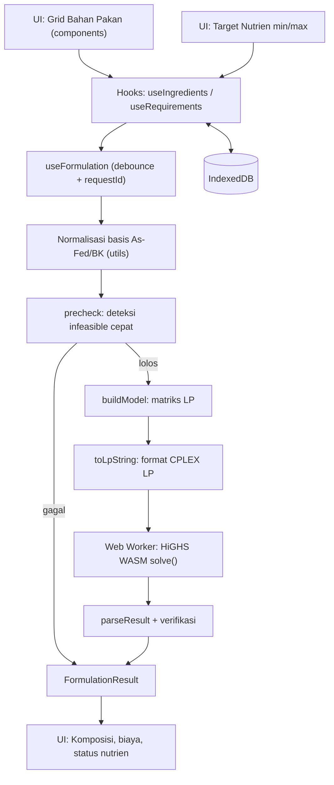
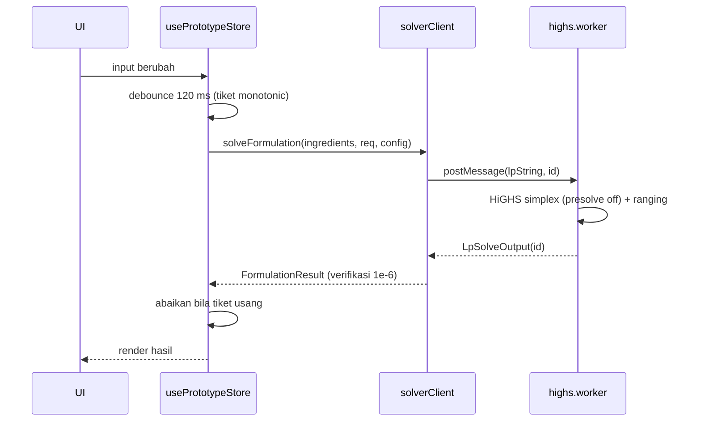

# Arsitektur OpenFormul

## Prinsip

1. **Client-side only** — tidak ada backend; solver berjalan di browser.
2. **Offline-first** — semua aset di-cache Service Worker, data di IndexedDB.
3. **Domain murni** — `src/solver` dan `src/utils` bebas React sehingga mudah diuji.

## Alur Data

## Urutan Eksekusi Solve

## Modul

| Folder           | Tanggung jawab                                                                                                                                                                                                                                                                                                                                                                                                                                                                                                                                                                                                                                                                                                                                                                                                                                                                                                                                       |
| ---------------- | ---------------------------------------------------------------------------------------------------------------------------------------------------------------------------------------------------------------------------------------------------------------------------------------------------------------------------------------------------------------------------------------------------------------------------------------------------------------------------------------------------------------------------------------------------------------------------------------------------------------------------------------------------------------------------------------------------------------------------------------------------------------------------------------------------------------------------------------------------------------------------------------------------------------------------------------------------- |
| `src/types`      | Tipe domain kanonik                                                                                                                                                                                                                                                                                                                                                                                                                                                                                                                                                                                                                                                                                                                                                                                                                                                                                                                                  |
| `src/data`       | Sampel bahan JSON, klasifikasi 8 kelas pakan (`feed-classes`), **22 standar SNI bertahun terbit** (`sni-requirements`), dataset kerja (`mock-state`), **304 bahan** Hartadi 1980 (`hartadi-feeds`), **82 profil** Kearl 1982 & **24 profil** NRC 1988 (`kearl-requirements`)                                                                                                                                                                                                                                                                                                                                                                                                                                                                                                                                                                                                                                                                         |
| `src/solver`     | `precheck`, `buildModel`, `toLpString`, `parseResult`, `solveFormulation`, `highs.worker`, `solverClient`, `iis`, `criticalStepping`, `enzymes`, `stochastic`, `rumenEvaluator`, `ingredientAdvisor` (rekomendasi bahan prioritas Indonesia)                                                                                                                                                                                                                                                                                                                                                                                                                                                                                                                                                                                                                                                                                                         |
| `src/storage`    | `db` (IndexedDB `idb` `openformul-db` v1 + merge non-destruktif preset SNI baru), `recipeTransfer` (`.feed.json`), `exportCsvXlsx` (CSV BOM & OOXML `.xlsx`), `exportPdf` (PDF 1.4 kolom rapi: formula lengkap, lembar timbang gudang, katalog bahan, & resep)                                                                                                                                                                                                                                                                                                                                                                                                                                                                                                                                                                                                                                                                                       |
| `src/i18n`       | Kamus & helper bilingual `ID / EN` (`pickLang`, label kategori/spesies/status/tier, terjemahan diagnostik konflik & IIS)                                                                                                                                                                                                                                                                                                                                                                                                                                                                                                                                                                                                                                                                                                                                                                                                                             |
| `src/utils`      | `basis` (As-Fed ↔ BK termasuk skala `stdDev` & `phytateP`), `equations`, `validators`, `ingredientCsvImport`, `tsvPaste`, `download`, `locale-number`, `cn`                                                                                                                                                                                                                                                                                                                                                                                                                                                                                                                                                                                                                                                                                                                                                                                          |
| `src/hooks`      | `usePrototypeStore` (orkestrasi solve live, hidrasi & persistensi IDB, non-destructive `loadRecipe`), `usePwaStatus`                                                                                                                                                                                                                                                                                                                                                                                                                                                                                                                                                                                                                                                                                                                                                                                                                                 |
| `src/theme`      | Sistem multi-tema **7 palet × Light/Dark (14 varian)** + **UI Enhancer (Acrylic Glass & Volumetric Glow)** + **Rendering & Motion Engine** (`ultra` \| `balanced` \| `crisp`, `gpu_flip` \| `css_native`, slider Blur/Glow) + Android OLED `#000000` (`themes.css`, `neumorphism-shadows.css`, `mobile-adaptive.css`, `palettes.ts`, `ThemeProvider.tsx`), sinkronisasi `<meta name="theme-color">` & manifest (`pwa-theme-sync.ts`), serta jembatan luminansi StatusBar/NavigationBar Capacitor (`android-theme-bridge.ts`)                                                                                                                                                                                                                                                                                                                                                                                                                         |
| `src/components` | UI presentasional berlapis **3-Layer Acrylic Glass** (`backdrop-filter: blur + saturate(165%)`, _specular rim light_ `1.2px`, bayangan berwarna palet), sidebar dengan tombol utama `Formulasi Ransum` 1,5x + _glowing pill_ (serta _liquid cutout_ menyatu rata tanpa celah saat UI Enhancer nonaktif) & `TrakteerSupportButton`, gelombang kaca _ambient glassmorphism_ kanan atas, _zero-hardcut_ `AnimatedTextSwap`, tabel split Bahan Digunakan vs Semua Bahan transparan, meter kedekatan Target Nutrien (`computeNutrientProximityMeter`: 100% tepat target, proporsional + peringatan amber/merah saat kurang/berlebih), ringkasan `Capaian Nutrien Hasil Formulasi` di `ResultsPanel`, seleksi teks solid pada UI chrome/touch dengan `.selectable-panel` di PC, grafik reaktif tema, kontras utilitas header Light/Dark, `ThemeSwitcherMenu` & kontrol Engine + cek update GitHub di `SettingsPage`, font offline `@fontsource-variable/*` |

## Offline, PWA & Deploy Lintas Platform (Fase 4)

- `vite-plugin-pwa` (`mode: "generateSW"`, `registerType: "autoUpdate"`) dengan `base` dinamis via `VITE_BASE_PATH` (`/OpenFormul/` di GitHub Pages, `/` di lokal/root), `start_url: "./"`, `scope: "./"`, `public/manifest.webmanifest` beserta `pwa-theme-sync.ts` (pembaruan reaktif `<meta name="theme-color">`, `apple-mobile-web-app-status-bar-style`, & Blob manifest), dan `maximumFileSizeToCacheInBytes: 6 * 1024 * 1024` untuk _precache_ aset statis serta `highs-*.wasm`.
- **Instalasi Desktop & Mobile (`usePwaStatus.ts`):** Menangkap `beforeinstallprompt` dan menyediakan tombol instalasi native di `AppShell` dan `SettingsPage` + bundel portabel di GitHub Releases.
- **Aplikasi Native PC `.exe` & Android `.apk`:** Selain PWA web, repositori dibungkus dengan **Tauri v2** (`src-tauri/`) untuk installer Windows NSIS (`.exe`) dan **Capacitor 8** (`android/`, `capacitor.config.json`, `android/app/src/main/res/values/colors.xml` & `styles.xml`) dengan jembatan status bar/navigasi dinamis (`android-theme-bridge.ts`) menggunakan script `npm run build:native` (`mode === "native"`, menonaktifkan registrasi Service Worker agar aset lokal langsung dijalankan WebView). Ekspor file di [download.ts](../src/utils/download.ts) otomatis memilih dialog Save As (`@tauri-apps/plugin-dialog` + `@tauri-apps/plugin-fs`), Android Share/Filesystem (`@capacitor/filesystem` + `@capacitor/share`), atau Blob web sesuai runtime.
- IndexedDB via `idb` (`openformul-db` v1) dengan 5 object store: `ingredients`, `requirements`, `recipes`, `active_session`, dan `preferences` (beserta fallback memori aman jika IndexedDB diblokir/tidak tersedia).
- **Modul Lanjutan (`AdvancedModulesPreview.tsx`):** Menyediakan 5 kartu pintasan aktif ramah peternak yang langsung mengarahkan ke fitur live (`ShadowPriceTab`, `WhatIfManualLock`, `PrecisionEngineDialog`) serta 3 rencana pengembangan pasif tanpa jargon teknis internal (pemetaan riset lengkap `PR-01` s/d `EN-05` tetap didokumentasikan di [advanced-feature-research-plan.md](advanced-feature-research-plan.md)).
